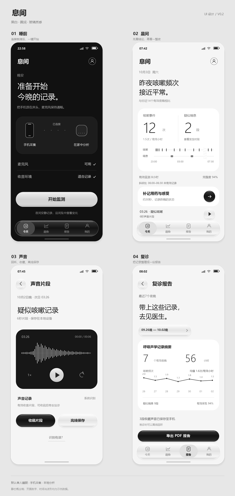

# 息间 · 居家呼吸声学监测与 RK3576 边缘端平台

面向成年哮喘患者的居家夜间呼吸声音记录项目。目标流程为手机采集声音、RK3576 本地分析，再通过患者应用查看咳嗽与疑似喘息记录，整理复诊资料。全部默认单人睡眠。

仓库包含患者应用、产品与 UI 设计、项目简介、商业计划书资料及文档生成脚本。

## 当前实现

患者应用位于 [`app/`](app/)，使用 React、TypeScript 和 Vite，提供适配手机的 Web/PWA 界面：

- 黑白灰配色、圆角布局与玻璃质感按钮。
- 晨间概览、事件时间轴、7/14/30 天趋势。
- 声音播放、收藏、离线保存、删除与误识别反馈。
- 用药症状记录、中文 PDF 报告导出。
- 本地加密存储、保留期限与数据清除。
- 真实麦克风前台短时采集，以及局域网设备健康检查。

**功能范围：** 当前为应用首版，真实采集暂限前台 5 分钟。整夜后台录音、音频连续传输与 RK3576 识别模型尚未接入。实际采集显示“待分析”，不生成模拟识别结果。默认示例体验使用固定合成数据，试听音也明确标为合成音频。

## 启动应用

需要 Node.js 22.12+ 和 npm。

```bash
git clone https://github.com/NLTuring/xijian-rk3576.git
cd xijian-rk3576/app
npm ci
npm run dev
```

打开终端显示的地址，默认为 `http://127.0.0.1:5188`。手机麦克风需要 HTTPS 或本机 localhost 环境。

```bash
npm run build          # 类型检查和生产构建
npm test               # 核心逻辑测试
npm run test:coverage  # 核心领域与服务层覆盖率
npm run test:e2e       # 浏览器流程测试，默认使用已安装的 Chrome
```

完整说明见 [应用 README](app/README.md)，设备连接契约见 [设备接口文档](app/docs/device-api.md)。

## 项目资料

| 内容 | 文件 |
| --- | --- |
| 项目简介 | [居家呼吸声学监测算法与 RK3576 边缘端部署平台](居家呼吸声学监测算法与RK3576边缘端部署平台-项目简介.docx) |
| 商业计划书写作框架 | [商业计划书设计纲要](商业计划书设计纲要.docx) |
| 商业计划书样板 | [商业计划书样板（简略版）](商业计划书样板（简略版）.docx) |
| 产品与界面设计 | [息间 UI 与功能设计方案](设计方案/息间-UI与功能设计方案.md) |
| 市场研究 | [市场与竞争格局研究简报](市场与竞争格局研究简报.md) |
| 文档生成方式 | [构建说明](构建说明.md) |

## 界面预览

以下为静态设计概览，数字、波形与结论为示例；应用实际页面截图见 [`app/docs/screenshots/`](app/docs/screenshots/)。



## 目录

```text
app/                    患者应用源码、测试、设备协议和使用说明
设计方案/               UI 与功能方案、概念图
*.docx                  项目简介及商业计划书资料
content.py              项目简介内容
bp_*_content.py         商业计划书内容
build_*.py              文档生成脚本
make_*.py               架构图、市场图与 UI 图生成脚本
```

项目资料中的算法指标、临床用途及设计目标应按各文档标注区分，不代表已完成的设备或临床验证。
