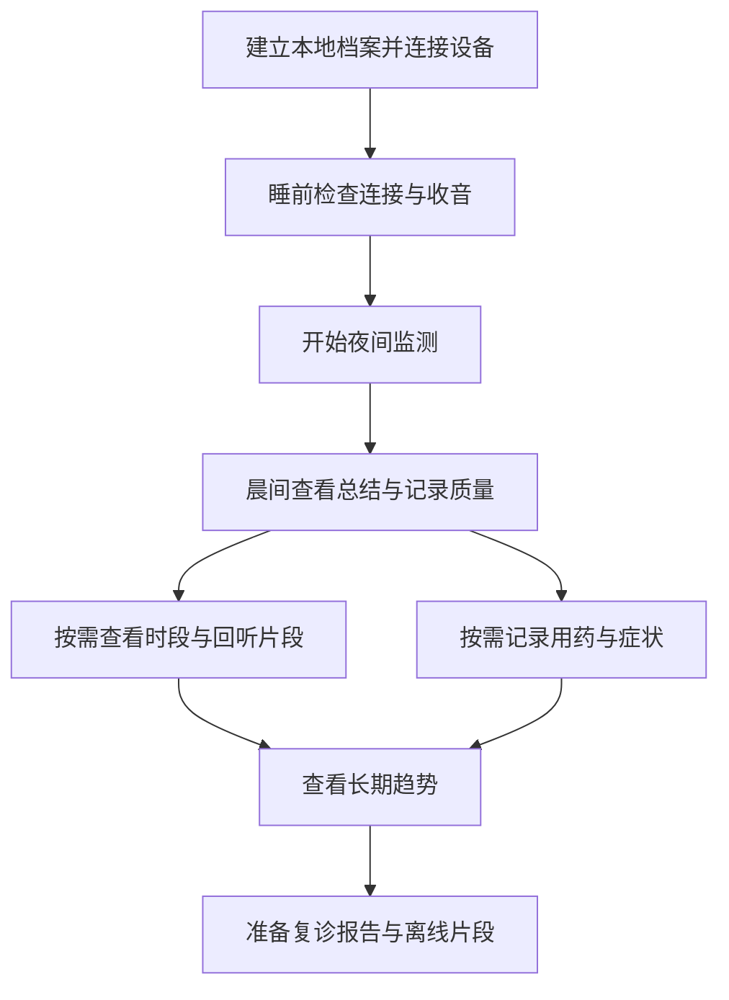

# 息间 UI 与功能设计方案

版本：V0.2 · 2026-10-04 · 患者 APP 设计蓝图

“息间”为建议的暂用产品名。本方案面向成年哮喘患者的单人睡眠监测，定义患者 APP、设备连接与复诊准备体验。配套图片是静态设计稿，日期、时间、声音片段和统计均为示例数据，不代表已经运行的监测结果。设备能力、算法效果与个人比较阈值仍需验证。

## 产品定义

睡前将手机放在床头，由手机采集夜间声音，RK3576 设备在本地分析。醒来先看一句昨夜总结，再按需要查看咳嗽频次、疑似喘息时段与声音片段；用药和症状记录以约 30 秒完成为设计目标，长期记录可整理成复诊报告。

全部监测默认单人睡眠，开始监测时直接检查设备连接与收音条件。晨间总结和统计自动呈现，回听、类型反馈和用药症状记录均由用户按需打开。

视觉采用纯黑、白、灰，轮廓圆润、留白宽松。正文与数据保持平面、清楚；玻璃液晶质感集中在主按钮和浮动导航，通过半透明表面、细边缘高光和浅阴影表现层次。

## 核心需求与范围

| 项目 | 当前方案 |
|---|---|
| 核心用户 | 成年哮喘患者本人 |
| 使用场景 | 单人睡眠，夜间居家自动监测 |
| 主界面 | 手机 APP |
| 采集与分析 | 手机床头收音，RK3576 本地分析 |
| 晨间信息 | 一句话总结优先，其后为时间轴、指标与个人参照 |
| 首版指标 | 咳嗽事件数、每有效小时咳嗽频次、疑似喘息发生时段 |
| 记录可信度 | 有效时长、记录完整度、采集质量与缺失时段 |
| 声音留存 | 关键事件短片段，本地保存，可回听、收藏与删除 |
| 主动记录 | 用药确认、症状自评、可选备注；约 30 秒为设计目标 |
| 类型反馈 | 对单个事件反馈“识别有误”，保留修正记录 |
| 趋势提醒 | 晨间集中呈现客观变化 |
| 复诊用途 | 预览并导出报告，准备关键片段的手机离线回听 |
| 本轮交付 | 产品方案与静态界面概念图 |

## 页面结构与导航

底部四个入口为：**今天、趋势、报告、我的**。“今天”随睡前、监测中与晨间改变内容，名称保持一致。用药和症状记录同时可从首页及趋势页的具体日期进入。

| 页面 | 核心内容 | 主要操作 |
|---|---|---|
| 今天／睡前 | 日期、设备状态、简明手机摆位提示、收音检查 | 开始今晚监测 |
| 今天／监测中 | 已采集时长、实际采集状态、开始时间 | 暂停、结束 |
| 今天／晨间 | 一句话总结、整夜时间轴、咳嗽与疑似喘息指标、记录质量 | 点选时段、回听片段、补记用药症状 |
| 事件详情 | 发生时间、检测类型、实际片段时长、播放进度、保存状态 | 播放、类型反馈、收藏、删除 |
| 轻量记录 | 昨晚用药情况、症状感受、可选备注 | 保存、稍后记录 |
| 趋势 | 7／14／30 天变化、个人参照、有效记录范围、用药症状记录 | 选择日期、查看对应夜晚 |
| 报告 | 日期范围、内容预览、关键事件索引、离线片段状态 | 导出 PDF、准备离线片段 |
| 我的／设备 | 设备名称、连接状态、储存空间、最近成功分析时间 | 配对、重连、查看问题 |
| 我的／隐私与数据 | 保存位置、留存期限、删除进度、导出范围 | 管理音频、删除、导出 |

面向用户时，RK3576 称为“本地分析设备”或用户设置的设备名称。具体型号与模型版本放在设备详情及报告追溯信息中。

## 四个关键场景

### 1. 睡前：准备清楚，一步开始

首屏给出“准备今晚的记录”，下面依次展示本地设备连接与手机收音状态。准备项用简单图标、文字和细分隔线组织；只在发生问题时显示具体处理入口。

手机摆位图示说明放在稳定床头表面、麦克风保持通畅。适用距离依据设备测试结果确定。首次使用完成本地档案、录音权限说明、设备配对与简短收音检查，之后记住常用设备。

主按钮“开始今晚监测”采用宽大的圆角玻璃表面，位置稳定、触摸范围充足。监测中显示已采集时长和当前状态，动画只表达采集正在运行，不模拟实时呼吸或睡眠分期。

### 2. 晨间：一句结论，展开整夜记录

阅读顺序为日期、一句话总结、个人比较依据、核心指标、整夜时间轴、可回听片段和用药症状入口。总结字号克制，重要数字使用适度放大的数字与清楚的单位。

时间轴从实际监测开始时间延伸到结束时间，清楚标注小时刻度。咳嗽用短竖线，疑似喘息用带纹理的区间条，采集缺口用灰色断带与文字提示；同时保留图例。标记密集时聚合显示数量，点击后展开该时段的事件列表。

事件标记可扩大触摸范围，实际持续时间在详情中显示。时间轴可以按时段展开，不让微小标记成为唯一入口。首页直接露出一条可回听片段，显示时间、事件类型和播放按钮。

有效监测时长与完整度合并成一行次要信息；异常时上移到总结附近。设备连接和分析进度只在影响当前使用时展开，避免重复展示完成状态。

### 3. 事件：看清时间，主动回听

事件详情保留所在夜晚与发生时间，展示“疑似咳嗽”或“疑似喘息”等检测类型、实际片段时长及保存位置。用户点击播放后才发声，播放、暂停和进度始终可见。

波形仅在真实音频可用时根据该片段生成；静态设计稿中的示意波形不代表实际检测结果。片段不可用时说明具体原因，并保留可读取的事件摘要。

“识别有误”作为次要入口，允许反馈事件类型错误，例如将疑似咳嗽标记为其他声音。反馈只作用于当前事件，可撤销；保留原始检测、反馈内容与时间。是否更新统计依据后续确定的反馈规则执行，重算时给出明确状态。

### 4. 复诊：一份报告，随时找到依据

“准备复诊”先选择日期范围，再预览咳嗽频次、疑似喘息时段、用药症状记录及数据质量。报告以白底深色文字呈现，便于手机阅读与打印。

用户可收藏需要讨论的事件。出门前，APP 检查这些片段是否已在手机可用，并提供主动保存到手机加密存储区的入口。完成后标记“可离线回听”，便于诊室内查看。

默认 PDF 包含统计、发生时间、记录质量与用户记录。声音通过 APP 的本地事件页回听。分享前明确展示报告日期范围和实际包含的信息。

## 关键流程与轻量记录

首次档案以建立个人记录所需的信息为限。设备配对可考虑机身扫码与局域网发现，具体入口需与硬件能力确认。简短收音检查应反映实际链路状态，例如“收音正常”“环境声音较多”“麦克风可能受遮挡”。未经校准的手机不展示看似精确的环境声压级。

用药支持用户维护常用项目，次日通过“按原计划使用／有变化／未记录”快速记录；选择变化时再展开细节。症状使用简明选项，备注可跳过。约 30 秒是交互设计目标，需要通过实际任务验证。

睡前发现连接或收音问题时，直接提供对应操作。夜间问题采用低打扰的状态提示，晨间说明受影响时段。用户可先查看总结与趋势，之后再补充个人记录。

## 晨间总结与统计口径

先判断数据是否足够解释，再选择对应总结。文案描述监测记录中的现象，避免从声学事件直接推导疾病诊断或用药建议。

| 记录情况 | 示例文案 | 进一步查看 |
|---|---|---|
| 数据可比较，处于个人参照范围内 | 昨夜咳嗽频次接近平常 | 昨夜时间轴与比较依据 |
| 数据可比较，咳嗽频次较高 | 昨夜咳嗽比平常多，主要集中在凌晨 | 集中发生的时段 |
| 个人参照尚在建立 | 已记录第 3 个有效夜晚，正在建立个人参照 | 已有记录 |
| 采集存在明显缺口 | 昨夜有一段时间未能有效记录 | 缺失时段与原因 |
| 有记录但质量不足以比较 | 昨夜有效记录不足，暂不能与平常比较 | 记录质量与收音建议 |
| 有效采集内没有检出目标事件 | 有效记录的 8 小时内，未检出咳嗽事件 | 有效时段与记录完整度 |
| 尚无当晚记录 | 今晚开始第一段夜间记录 | 睡前准备 |

以上为状态文案示例，数字随实际记录更新。设计稿中展示的结论只用于演示界面层级。

咳嗽同时显示事件数和每有效小时频次。事件数需经过合并与去重，不直接使用音频模型窗口数；频次分母为有效监测时长。疑似喘息以发生时段为主要表达，可补充合并后的段数与累计时长，具体统计口径需通过算法验证。

个人比较使用一致的统计口径、采集质量规则与可比监测时段。近期约 14 个有效夜晚可作为待验证的参照方案；最低有效夜数、有效时长要求与变化阈值尚未确定。界面展示实际使用的参照范围，条件不足时说明原因。

无记录、无效数据、未检出事件分别呈现。缺失时段保留缺口，不纳入有效时长分母，不填成零事件。记录完整度定义为有效监测时长占本次开始至结束总时长的比例，主动暂停等非有效时段保留其原因；有效性规则仍需验证。开始监测时间不等同于入睡时间，首版不推断睡眠分期。

## 趋势与复诊报告

趋势页共用日期轴呈现咳嗽频次、疑似喘息时段、用药记录与症状自评。图形使用线型、点形、纹理与文字区分指标，缺失日期保留断点。选择某一天可进入该夜的时间轴和声音事件。

每晚按开始监测的当地日期归档，同时保留完整起止时间；跨午夜的记录作为同一晚呈现。个人参照以细线或浅灰参考区间显示，仅在可比样本足够时呈现，并注明统计范围。不同指标采用各自清楚的单位，避免在同一纵轴混用次数、频次与时长。

复诊报告包含：

1. 日期范围、监测夜数、有效监测时长及记录完整度。
2. 咳嗽频次变化与疑似喘息发生时段。
3. 用药记录、症状自评与用户备注。
4. 数据缺失、质量不足的时段及个人比较条件。
5. 用户收藏的关键事件索引，方便当面查找声音依据。

报告保留生成时间、记录版本与必要的算法版本信息。事件类型反馈导致统计修订后，提示重新生成报告；已经导出的文件保留原来的生成日期与内容。报告呈现监测记录，临床用途与算法表现需通过后续验证。

## 本地保存与异常状态

连续声音在处理链路中用于分析，长期保存以关键事件片段与摘要为主。处理所需的短暂缓冲、片段保存期限及删除行为，应在隐私设置中清楚说明。

设计要求为关键片段在本地分析设备中加密保存，APP 缓存摘要，用户主动选择的片段可加密保存到手机。事件页区分“设备中”“手机可离线播放”“声音已过期”等实际状态。这些是待实现并验证的能力要求。

留存期限与剩余空间放在同一页。默认期限可先按 30 天设计，再结合存储容量与随访周期验证。收藏的复诊片段应显示独立的保留状态及到期时间。

| 情况 | 界面状态 | 处理要求 |
|---|---|---|
| 外网断开，手机与本地设备仍正常连接 | 按实际状态显示本地记录 | 本地采集、分析与查看以不依赖外网为目标，需验证 |
| 手机与本地设备短暂断连 | 本地设备连接中断 | 仅在已验证的缓冲范围内等待恢复并补处理 |
| 断连超过可用缓冲范围 | 对应时段存在记录缺口 | 标明实际丢失范围及原因 |
| 来电或权限变化导致麦克风不可用 | 采集已中断 | 记录中断时间，提供恢复入口 |
| 环境或遮挡导致质量不足 | 该时段记录质量不足 | 按质量规则排除无效部分，更新有效时长 |
| 分析尚未完成 | 昨夜记录正在分析 | 显示实际进度或等待状态，完成后提供总结 |
| 片段到期删除 | 事件摘要可查看，声音已过期 | 关闭播放入口，保留摘要与留存记录 |
| 设备离线时请求删除其片段 | 删除待执行 | 设备确认完成后更新为已删除 |
| 用户提交事件类型反馈 | 反馈已保存，显示当前处理状态 | 保留原始检测与反馈时间，按确定的规则更新统计 |

短时缓冲的时限、容量与恢复机制必须经过验证。能力尚未验证时使用真实缺口状态；本地设备断连与外网断开使用各自清楚的说明。夜间长时运行、锁屏录音和中断恢复均属于原生实现前的验证项。

## 视觉与交互规范

| 元素 | 规范 | 应用 |
|---|---|---|
| 页面背景 | 白 `#FFFFFF` 或浅灰 `#F3F3F3` | 内容区与页面留白 |
| 主文字 | 近黑 `#151515` | 总结、指标、标题 |
| 次文字 | 深灰 `#626262` | 日期、说明、单位 |
| 分隔与辅助图形 | 灰 `#D8D8D8` | 分隔线、非正文刻度 |
| 强调色 | 黑、白及灰阶 | 选中状态、主操作、数据标记 |
| 内容圆角 | 24–32 逻辑像素 | 主要内容区、可操作卡片 |
| 主按钮与浮动导航 | 圆润玻璃表面，黑白透明度层次、细边缘高光、浅阴影 | 关键操作与页面切换 |
| 正文与数据 | 平面、实色、清楚对比 | 时间轴、摘要、数字、报告 |

整体限定黑白灰。玻璃液晶效果通过局部明暗、清晰边缘与轻微折射感表达；主按钮保持可辨的实色文字，底部导航使用稳定的半透明底层。背景模糊与透明度不能影响文字阅读；系统降低透明度时，改用实色表面。

大面积内容避免反复套卡片。相关数据用对齐、留白和细分隔线建立层级，只有独立操作、重要分组和详情浮层使用容器。首页以一句话总结和可读时间轴组织信息，装饰不占用数据阅读空间。

中文采用系统无衬线字体。总结建议 24–28 逻辑像素，指标数字 36–44，正文 16，说明 14；使用常规与中等字重控制层级。单位紧随数字，较长文案自然换行。内容区左右留白建议 24 逻辑像素，分组间距 24–32。

主按钮高约 56 逻辑像素，主要触摸区域至少 48 逻辑像素。浮动导航保留底部安全区，内容滚动区预留足够空间，避免遮挡列表最后一项。选中项使用深浅反差、图标与文字共同表达。

时间轴上咳嗽、疑似喘息和缺失区间通过形状、线型与图例区分。缺失提示保留可读文字。支持系统字体放大、屏幕阅读器、减少动态效果及减少透明度。夜间可使用相同灰阶规范的低亮度深色状态。

动效用于短暂的按压、页面切换与播放反馈；持续状态使用静态指示即可。玻璃表面不使用持续流光，数据图形不以动画模拟未测得的生理信号。

## 配套静态概念图

四张图分别展示睡前准备、晨间概览、事件详情与复诊报告。图片中的数据和波形为界面示例，按钮用于表达计划中的交互，不代表应用功能已经实现。

- [睡前准备](concepts/01-bedtime.png)
- [晨间概览](concepts/02-morning.png)
- [事件详情与回听](concepts/03-event.png)
- [复诊报告](concepts/04-report.png)

## 后续细化与验证

交互验证围绕首次连接、开始监测、理解晨间总结、回听与事件类型反馈、补记用药症状、准备报告展开。重点观察用户能否理解事件数与每有效小时频次的区别，能否辨别缺失数据、质量不足与未检出事件，以及是否能快速找到具体时段。

用药和症状记录以约 30 秒为目标，需记录实际完成时间与中断后的恢复情况。主要任务验证单手操作、字体放大、低亮度、减少透明度和减少动态效果下的可用性。

实现前验证手机锁屏与后台录音、夜间长时局域网传输、来电中断恢复、板端分析和短时缓冲。算法验证确定咳嗽与喘息检测表现、事件合并规则、质量判定、类型反馈处理和个人参照阈值，再据此决定可显示的结论范围。

项目依据：

- [项目简介](../居家呼吸声学监测算法与RK3576边缘端部署平台-项目简介.docx)
- [项目构建说明](../构建说明.md)
- 本次对话确认的当前需求，汇总见本文“核心需求与范围”。
